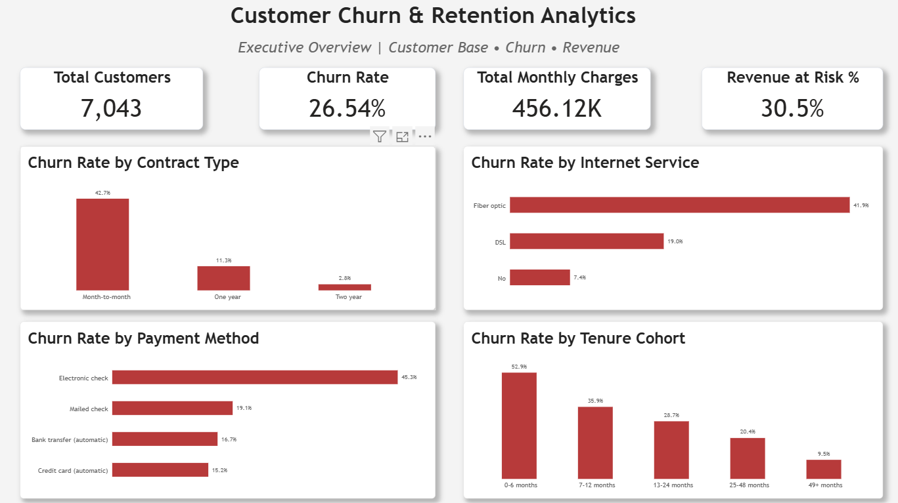
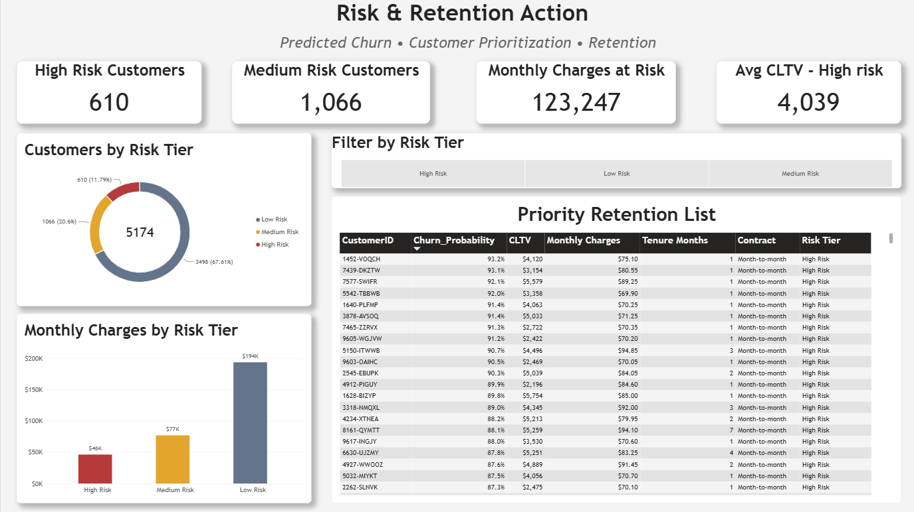

# Customer Churn & Retention Analytics

I built this project to answer a simple business question: **why are customers leaving a telecom company, and which of the customers who are still here are most likely to leave next?**

Using the IBM Telco Customer Churn dataset, I worked through the whole process: cleaning and exploring the data in Python, quantifying the business impact with SQL, building a machine learning model to predict churn, and putting the results into a two-page Power BI dashboard.

## Dashboard Preview

### Page 1: Executive Overview



### Page 2: Risk & Retention Action



## What I Wanted to Find Out

- How many customers are churning, and how much revenue does that represent?
- Which customer groups churn the most (contract, payment method, internet service, tenure)?
- Can a model predict churn well enough to be useful?
- Which active customers should a retention team look at first?

## Tools Used

| Tool | What I used it for |
|---|---|
| Python (pandas) | Cleaning and preparing the data |
| Matplotlib  | Exploratory charts |
| MySQL | Business analysis with SQL |
| Scikit-learn | Churn prediction models |
| Jupyter Notebook | Writing and documenting the analysis |
| Power BI | Interactive dashboard |

## How the Project Is Organised

**1. Exploratory Data Analysis (Python)**
I started by cleaning the data. The main issue was `Total Charges`, which was stored as text. The blank values belonged to brand-new customers with zero tenure, so I filled them with 0 instead of dropping them. Then I looked at churn across contracts, payment methods, internet service, tenure, demographics, add-on services, and the reasons customers gave for leaving.

**2. SQL Analysis (MySQL)**
I loaded the cleaned data into MySQL and wrote 10 queries aimed at business questions rather than repeating the EDA. They cover revenue tied to churn, tenure cohorts, contract and payment method combinations, add-on bundling, window function rankings, and a compound high-risk segment (senior citizens with no dependents on month-to-month contracts).

**3. Machine Learning**
I compared two models: Logistic Regression as a baseline and Random Forest as a stronger option. I left out IBM's own Churn Score and CLTV columns when training, because they would leak information about the answer.

| Metric | Logistic Regression | Random Forest |
|---|---:|---:|
| ROC-AUC | 0.8489 | **0.8518** |
| Accuracy | 0.74 | **0.77** |
| Precision (churn) | 0.51 | **0.55** |
| Recall (churn) | **0.78** | 0.74 |
| F1-score (churn) | 0.62 | **0.63** |

The two models are close. I went with Random Forest for its slightly better ROC-AUC, precision, and F1. Logistic Regression catches more of the customers who actually churn (higher recall), so it would also be a reasonable choice if missing a churner is considered the costlier mistake.

After picking Random Forest, I retrained it on the full dataset and scored every active customer with a churn probability. I then sorted them into risk tiers:

| Risk Tier | Churn Probability | Customers | Monthly Charges (USD) |
|---|---|---:|---:|
| High Risk | 0.60 and above | 610 | 46,269.85 |
| Medium Risk | 0.30 to 0.60 | 1,066 | 76,977.45 |
| Low Risk | below 0.30 | 3,498 | 193,738.45 |

High and Medium Risk customers together come to 1,676 active customers and about 123,247 USD in monthly charges.

**4. Power BI Dashboard**
Page 1 explains where churn is happening. Page 2 is built for action: risk tier counts, monthly charges by tier, a tier filter, and a priority list of customers sorted by churn probability.

## Key Findings

1. **Overall churn is 26.54%.** Roughly one in four customers in the dataset had left.
2. **Contract type matters most.** Month-to-month customers churned at 42.71%, against 2.83% for two-year contracts.
3. **Fiber optic customers churned at 41.89%**, the highest of the internet service types, even though it is the premium service.
4. **Electronic check users churned at 45.29%**, compared with roughly 15-17% for customers on automatic payments. The gap held within every contract type.
5. **New customers are the most at risk.** Churn was 52.94% in the first 6 months and 9.51% after 49 months or more.
6. **Churned customers account for 139,130.85 USD in monthly charges**, about 30.5% of the total. That is higher than the 26.54% customer churn rate, so the customers leaving tend to pay more than average.
7. **Add-ons don't help in a straight line.** Customers with exactly one add-on churned more (38.85%) than customers with none (29.75%). Churn only dropped sharply at two or more.
8. **Risk and value don't line up.** High Risk customers had the lowest average CLTV of the three tiers, so churn probability alone isn't enough to decide who to prioritise.

These are patterns in the data and should not be read as proof of what causes churn.

## Business Recommendations

- Give new customers extra attention in their first few months, such as onboarding and early check-ins.
- Offer sensible contract upgrades to month-to-month customers who also have a high predicted churn probability, instead of targeting everyone.
- Look into service quality and support experience for Fiber optic customers.
- Encourage automatic payment options and make switching easy.
- Use predicted churn probability together with customer value (CLTV) when deciding where to spend retention effort.
- Test these ideas through controlled retention campaigns before assuming they work.

The full write-up is in [Business_Recommendations.md](Business_Recommendations.md).

## Limitations

- The findings are observational, so they show associations, not causes.
- The final risk scores come from a model retrained on the full dataset, which makes the probabilities somewhat optimistic for customers the model saw during training. A real system would score new, unseen customers.
- The 0.60 and 0.30 risk thresholds are business-defined choices, not calibrated values.
- The dataset is a single snapshot, so I couldn't look at how churn changes over time.

## Project Structure

```text
Customer Churn/
│
├── Dataset/
│   ├── Telco_customer_churn.xlsx
│   ├── telco_churn_cleaned.csv
│   ├── risk_scored_customers.csv
│   └── top_risk_customers.csv
│
├── Notebooks/
│   ├── 01_Telco_Churn_EDA.ipynb
│   ├── 02_Telco_Churn_SQL.ipynb
│   └── 03_Feature_Engineering_ML.ipynb
│
├── Dashboard/
│   └── Customer_Churn_Retention_Analytics.pbix
│
├── Images/
│   ├── dashboard_page1.png
│   └── dashboard_page2.png
│
├── Business_Recommendations.md
├── README.md
└── requirements.txt
```

## How to Run It

1. Clone the repo and install the packages: `pip install -r requirements.txt`
2. Run the notebooks in order (01, 02, 03). The cleaned data is saved by notebook 01 and used by the other two.
3. For the SQL notebook, you need a local MySQL server and a database called `telco_churn_db`. Set your password as an environment variable named `MYSQL_PASSWORD` instead of typing it into the notebook.
4. Open the `.pbix` file in Power BI Desktop to explore the dashboard. If the data sources show errors, point them to the CSV files in the `Dataset` folder.

## Dataset

[IBM Telco Customer Churn Dataset](https://www.kaggle.com/datasets/yeanzc/telco-customer-churn-ibm-dataset): 7,043 customer records with information on tenure, contract, payment method, internet service, monthly charges, total charges, and churn status.

## What I Learned

The biggest lesson was how much of this work is about checking my own results. I caught a ROC-AUC below 0.5 that turned out to be a scaling mismatch between training and evaluation, and I changed the final scoring step to retrain on the full dataset. I also learned that SQL becomes much more useful when it answers business questions instead of repeating what EDA already showed, and that a dashboard needs a clear audience and purpose for each page.

---

**Author:** Himanshu Pandey
**Tools:** Python, MySQL, Scikit-learn, Power BI, Jupyter Notebook